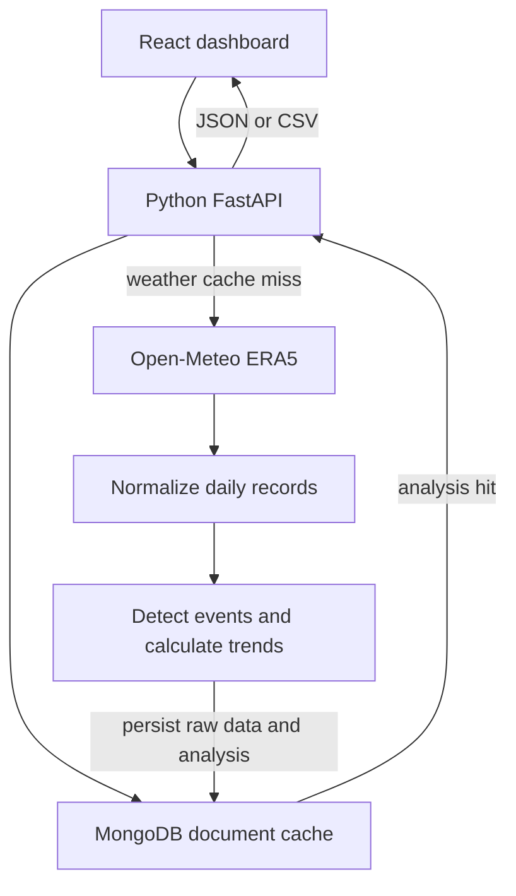

# Climate Lens — Climate Hazard Trend Analyzer

A React dashboard and Python API for understanding historical heatwave frequency, duration, and intensity at a selected geographic location. The application uses real **Open-Meteo ERA5 reanalysis**, a fixed reference period, and a NoSQL document cache. No generated weather data is used in the application.

## Features

| Requirement | Implementation |
|---|---|
| React frontend | React + TypeScript + Vite; responsive, accessible controls |
| Region selection | Curated cities, global city search, or custom latitude/longitude |
| Heatwave selected by default | The completed hazard is heatwave |
| Historical time range | Complete calendar years from 1940 through the last completed year |
| Frequency, duration, intensity | Annual series, interactive metric tabs, and a paginated event log |
| Honest summary insights | Equal-period comparisons, zero-baseline handling, and descriptive regression |
| Python backend | FastAPI with generated OpenAPI documentation at `/api/docs` |
| NoSQL persistence | MongoDB in cloud deployment; TinyDB document database for local development |
| Data handling | Missing dates, invalid values, duplicate dates, Celsius/Fahrenheit conversion, coverage reporting |
| Security and performance | Validated inputs, body limits, fixed upstream hosts, bounded requests, caching, rate limiting |
| Bonus export and trends | CSV export, browser print-to-PDF, ordinary least squares, three-year rolling average |

## Run locally — Windows

Install **Node.js 24 LTS**, **Python 3.12 or newer**, and Git. Open PowerShell in a folder where you want the project.

```powershell
git clone https://github.com/vinilgarrepelli/climate-hazard-analyzer.git
cd climate-hazard-analyzer
python -m venv .venv
.\.venv\Scripts\python.exe -m pip install -r requirements-dev.txt
npm ci
```

Start the Python backend in this terminal:

```powershell
.\.venv\Scripts\python.exe -m uvicorn backend.main:app --host 127.0.0.1 --port 8000
```

Open a second PowerShell terminal in the same project folder:

```powershell
npm run dev
```

Open **http://localhost:5173**. The Vite development server forwards `/api` requests to port 8000. Without `MONGODB_URI`, the local app stores real fetched weather and analysis documents in `.data/climate.json` using TinyDB. No account is needed for local use.

For macOS/Linux, use `python3 -m venv .venv`, `source .venv/bin/activate`, and `python -m pip install -r requirements-dev.txt`. The remaining commands are the same.

### Optional local MongoDB

Copy `.env.example` to `.env` and configure `MONGODB_URI` and `MONGODB_DATABASE`. Use a database user scoped to the project database. Do not commit `.env` or put credentials in frontend variables.

## Production deployment

The repository deploys as a **FastAPI Vercel project**. Its build command builds the React frontend into `public/`; Vercel serves those files through its CDN and executes the Python API as a function.

1. Import this repository into Vercel, with the repository root as the project root.
2. Choose the FastAPI preset. `vercel.json` already specifies the build command.
3. Add **encrypted** environment variables: `MONGODB_URI` and `MONGODB_DATABASE=climate_lens`.
4. Configure MongoDB Atlas network access for the chosen hosting environment and a least-privilege database account.
5. Deploy. Check `/api/health`; production must report `database: mongodb` and `status: ok`.
6. Run an analysis twice. The second response should report `cache.analysis: hit`.
7. Verify that the URL submitted to reviewers is accessible to them without your account.

**Production does not silently fall back to a temporary JSON file.** Vercel's filesystem is not durable database storage. A missing or unavailable MongoDB configuration produces a clear 503 response.

The optional private UI preview is built with `VITE_PREVIEW_MODE=true` and a verified `preview.json` snapshot. It is clearly labeled, fixed to Hyderabad 1990–2025, and is distinct from the complete Python/MongoDB application. The default production build does not enable this mode.

## Architecture



The frontend never calls a database or receives database credentials. The pure calculations in `backend/climate.py` do not depend on HTTP or storage, so they are easy to explain and test. Raw weather documents and computed analysis documents have separate cache keys and expiry times. Computed results are persisted before being returned; repeated API calls read them from the database.

## Data source and handling

- [Open-Meteo Historical Weather API](https://open-meteo.com/en/docs/historical-weather-api), using daily `temperature_2m_max`, `models=era5`, local timezone, and Celsius.
- ERA5 is an ECMWF/Copernicus **gridded reanalysis**, not a measurement from a station at the exact city coordinate. The response reports the selected grid point, timezone, elevation, and retrieval time.
- A consistent ERA5 model is used instead of the provider's changing “best match” mix.
- Every expected date is retained. Missing or invalid values become `null` and are not interpolated.
- Duplicate dates are excluded conservatively. Values outside −90°C to 65°C and non-finite numbers are excluded. Fahrenheit is converted when supplied; unsupported units and mismatched arrays are rejected.
- Baseline coverage must be at least 95%. Analysis years below 95% coverage are excluded from regression and drawn as gaps in the chart. Their detected event counts remain available as lower-bound observations in the annual table.
- Up to 90 days of context are requested around the full analysis/reference interval. Events touching the available data boundary are flagged as potentially truncated.

## Heatwave definition

The default indicator is **three or more consecutive calendar days** with daily maximum temperature **strictly greater than the 95th percentile** of valid daily maxima for that location during **1991–2020**.

The percentile uses linear interpolation, equivalent to the common type-7 definition. The threshold remains fixed when the displayed time range changes. Detection uses the unrounded threshold; UI values are rounded only for display.

This is an **all-season threshold** and a case-study climate indicator. It is not an official regional heatwave warning rule and is not a day-of-year/seasonally varying percentile. It emphasizes very hot days; unusual winter warmth may not qualify. A seasonally varying baseline would be a useful extension.

### Counting and interpretation

- Event frequency is attributed to the event's **onset year**. A run crossing New Year is one event.
- Heatwave days are assigned to their actual calendar year.
- The event log includes events overlapping the requested period. Full event durations can extend beyond the selected years; flagged boundary durations are lower bounds.
- Intensity is the mean/peak Celsius exceedance above the threshold during a detected event. No events means undefined intensity (`null`), rather than a fabricated zero.
- The main comparison uses the first and last equal, **non-overlapping** windows of up to five years. At least three years per window are needed, and every window year needs 95% coverage.
- If the initial mean is zero, percentage change is undefined; only absolute change is reported.
- Ordinary least squares is fit to reliable annual series. A three-year trailing average is available only when all three years meet coverage requirements. At least five reliable years are needed for regression.
- The application makes no claim of statistical significance, future prediction, health impact, or causal attribution. A small R² indicates that a straight line explains little of the observed variation.

## API

| Method | Path | Purpose |
|---|---|---|
| GET | `/api/health` | Application and database readiness |
| GET | `/api/regions` | Preset cities and supported complete years |
| GET | `/api/geocode?q=Hyderabad` | Cached city lookup |
| POST | `/api/analyze` | Persisted JSON analysis |
| POST | `/api/export/csv` | Annual indicators with method metadata |
| GET | `/api/docs` | Interactive OpenAPI documentation |

Example analysis request:

```json
{
  "latitude": 17.385,
  "longitude": 78.4867,
  "region_name": "Hyderabad, India",
  "start_year": 1990,
  "end_year": 2025,
  "hazard": "heatwave",
  "percentile": 95,
  "min_duration": 3
}
```

Validation errors return 422; oversized bodies 413; rate limits 429 with `Retry-After`; upstream failures 502; database failures 503. No synthetic fallback is used after a provider failure.

## Security and performance decisions

MongoDB has atomic, distributed fixed-minute counters (12 analysis/geocode/export requests per client per minute by default). Local TinyDB mode uses an in-process rolling-minute limiter. The production client address is taken from the hosting ingress; multi-proxy deployments should review this trust boundary. SHA-256 hashes are stored instead of raw client addresses.

External destinations are fixed in server code; users cannot supply URLs. Redirects are disabled, connect/read timeouts are enforced, responses are bounded at 4 MB, and a transient transport/5xx failure receives at most one retry. Input bodies are bounded at 4 KiB, extra fields are forbidden, dates/coordinates/rules are bounded, and NaN/infinity are rejected.

Cache documents expire after 30 days by default. MongoDB TTL indexes clean expired records, and reads also check expiry. Raw weather keys include coordinates, model, units, timezone, and the fetch interval; computed keys also include parameters and algorithm version. Concurrent identical cold weather requests are coalesced within a worker. Database credentials remain on the server. CSV cells exclude caller-supplied strings to prevent formula injection.

React charts are loaded in a separate bundle, long event lists are paginated, animations respect reduced-motion preferences, and requests are cancelled when replaced/unmounted. External fonts have local system fallbacks. Map selection is intentionally outside the completed core scope.

## Verification

```powershell
.\.venv\Scripts\python.exe -m pytest -q
npm run build
```

The 29 tests cover percentile interpolation, threshold equality, missing dates, null values, leap days, unit conversion, duplicates, outliers, year-boundary events, fixed baselines, coverage exclusion, zero denominators, regression slopes, cache reuse, CSV metadata, formula injection, input validation, body limits, rate limiting, upstream errors, and preventing temporary-file storage in serverless production.

Real Hyderabad ERA5 data for 1990–2025 was also fetched and processed on 13 October 2026. It contained 13,149 valid daily observations, 61 detected events, 465 heatwave days, and a 39.3°C threshold under this definition. The first/last five-year comparison showed fewer heatwave days in the latter window; the app reports this result honestly rather than assuming an increase. These figures can change after source revisions or method changes.

## AI assistance disclosure

This implementation used **OpenAI ChatGPT / Codex substantially** to plan the architecture, write React/TypeScript and Python code, create tests, investigate official documentation, diagnose build/runtime issues, and prepare deployment and demonstration documentation. Tools used included terminal/build tools, pytest, public documentation search, GitHub/Vercel integration tools, and secure browser-assisted account operations. AI-created weather data was not used.

The submitted code should be reviewed by the candidate before the interview. The candidate should be ready to explain the logic, describe the assumptions and limitations, and make live changes. See [the demonstration guide](docs/DEMO_GUIDE.md) and [the code walkthrough](docs/CODE_WALKTHROUGH.md).

## Improvements with more time

- Day-of-year percentile climatology, sensitivity analysis, and regional definitions.
- Mann–Kendall/Sen's slope with appropriate treatment of autocorrelation and uncertainty.
- Spatial aggregation over multiple grid cells and map selection.
- Reusable baseline datasets and incremental cache ingestion across overlapping date ranges.
- Distributed ingestion locks, explicit global upstream budgets, structured observability, and broader end-to-end browser tests.
- More hazards only after their scientific definitions and data requirements are validated.

The confidential assignment document and all account credentials are excluded from this repository.
